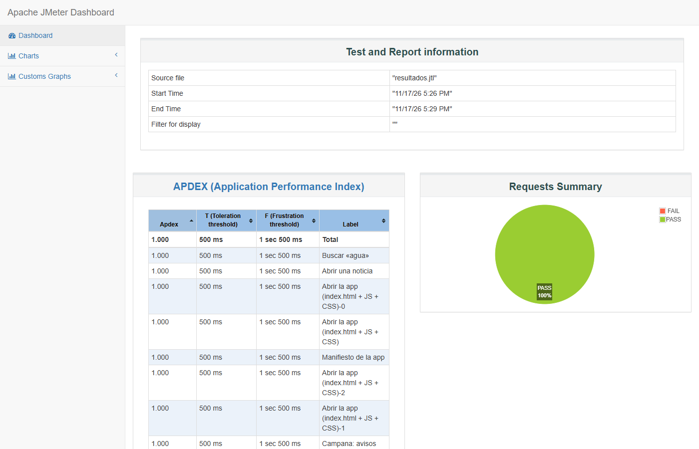
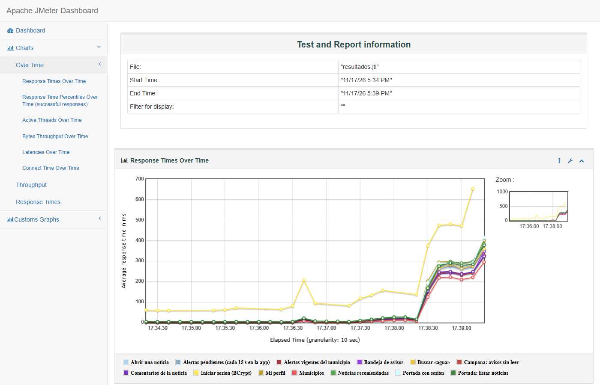
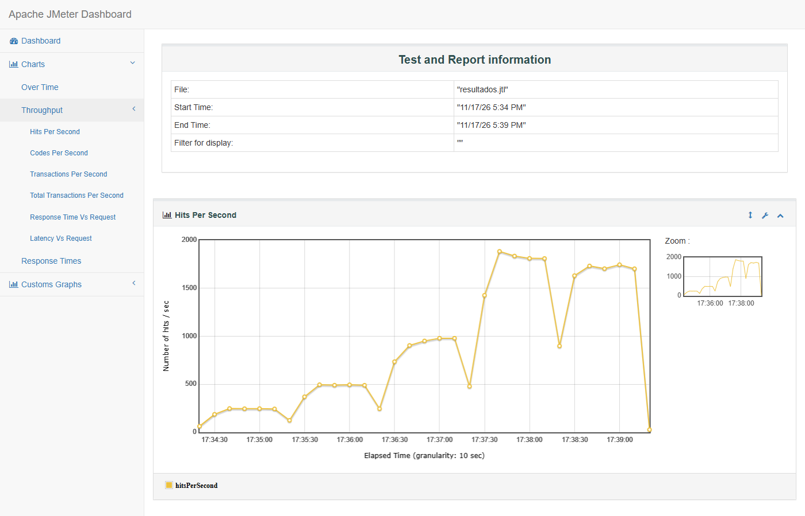

# Pruebas de carga y estrés con Apache JMeter

Fecha: 17 de noviembre de 2026 · Herramienta: **Apache JMeter 5.5** (imagen Docker `justb4/jmeter`)
Planes: [`pruebas/jmeter/carga.jmx`](../pruebas/jmeter/carga.jmx) y [`pruebas/jmeter/estres.jmx`](../pruebas/jmeter/estres.jmx)

## 1. Qué se probó y dónde

La aplicación completa en **Docker** (backend Spring Boot + PostgreSQL 17 + frontend en nginx), con el
código de la rama de despliegue (alertas de emergencia, adaptación a celular e inicio con Google).
JMeter corre en otro contenedor de la misma red de Docker y llama a `backend:8080` y `frontend:80`.

No se probó contra producción (Render y Neon gratuitos): sus planes tienen límites de CPU y de uso,
y una prueba de estrés los agotaría y mediría el plan gratuito, no la aplicación.

**Equipo:** 16 núcleos lógicos. JMeter corre en la misma máquina que la aplicación, así que en el
escalón más alto los dos compiten por la CPU (los números de ese escalón son conservadores).

### Escenarios (lo que hace cada usuario virtual)

| Tipo de usuario | Qué hace, en bucle | Pausa entre vueltas |
|---|---|---|
| **Visitante** | Portada (`GET /api/noticias`) → abre una noticia al azar → sus comentarios → recomendadas → busca «agua» → municipios | 1 a 3 s (carga) · 0,1 a 0,3 s (estrés) |
| **Con sesión** | Inicia sesión **una vez** (`POST /api/auth/login`, BCrypt) y en bucle: perfil, campana de avisos, alertas pendientes (lo que la app consulta cada 15 s), alertas vigentes, bandeja de avisos, portada | igual que arriba |
| **Navegador** (solo carga) | Abre la app: `index.html` con sus JS y CSS (recursos embebidos, caché limpia en cada vuelta) y el manifiesto | 2 a 5 s |

Cada petición se valida: debe responder 2xx (si no, cuenta como error).
Índice APDEX: satisfactorio ≤ 500 ms, tolerable ≤ 1,5 s.

## 2. Prueba de carga: el uso esperado

**50 usuarios simultáneos durante 3 minutos** (30 visitantes, 15 con sesión y 5 navegadores; rampa de 30 s).

| Resultado | Valor |
|---|---|
| Peticiones | **4.380** (24,5 por segundo) |
| Errores | **0 %** |
| Tiempo promedio | **3,9 ms** |
| Percentil 95 | **6 ms** |
| Percentil 99 | 8 ms |
| Máximo | 70 ms (inicio de sesión) |
| APDEX | **1,000** (todas las respuestas satisfactorias) |

| Petición | Promedio | p95 | Máximo |
|---|---:|---:|---:|
| Portada: listar noticias | 4,9 ms | 7 ms | 48 ms |
| Abrir una noticia | 3,5 ms | 5 ms | 15 ms |
| Buscar «agua» | 5,0 ms | 7 ms | 14 ms |
| Alertas pendientes | 3,9 ms | 6 ms | 7 ms |
| Iniciar sesión (BCrypt) | 63 ms | 70 ms | 70 ms |
| Abrir la app (HTML + JS + CSS) | 5,0 ms | 6 ms | 51 ms |

Uso de recursos: backend como máximo 32 % de un núcleo y 395 MB de memoria; base de datos 5 %; nginx menos de 1 %.

**Conclusión:** con el uso esperado la aplicación responde casi al instante y sin errores. El inicio de
sesión es lo más lento (unos 65 ms) porque BCrypt es lento a propósito: así protege las contraseñas.



## 3. Prueba de estrés: hasta encontrar el límite

Cinco escalones seguidos de **50, 100, 200, 400 y 800 usuarios** (60 s cada uno, rampa de 20 s), con pausas
cortas (0,1 a 0,3 s) para exigir al servidor. En cada escalón el 70 % lee sin sesión y el 30 % usa la app con sesión.

| Usuarios | Peticiones | Pet./s | Promedio | p90 | p95 | p99 | Máximo | Errores | Login p95 |
|---:|---:|---:|---:|---:|---:|---:|---:|---:|---:|
| 50 | 12.349 | 207 | 3 ms | 5 ms | 5 ms | 7 ms | 69 ms | 0 % | 64 ms |
| 100 | 24.669 | 412 | 3 ms | 5 ms | 5 ms | 7 ms | 91 ms | 0 % | 71 ms |
| 200 | 47.968 | 802 | 7 ms | 10 ms | 20 ms | 68 ms | 411 ms | 0 % | 191 ms |
| 400 | 92.581 | 1.544 | 16 ms | 36 ms | 54 ms | 104 ms | 349 ms | 0 % | 153 ms |
| **800** | 94.316 | **1.567** | **224 ms** | 385 ms | **450 ms** | 588 ms | 1.444 ms | **0 %** | 629 ms |

Total: **271.883 peticiones en 5 minutos, 0 errores.**
Uso máximo de recursos: backend 930 % (unos 9 núcleos) y 754 MB; PostgreSQL 436 % (unos 4 núcleos).

**Conclusiones:**

1. **Hasta 400 usuarios muy activos** el sistema escala casi en línea recta: el doble de usuarios da el
   doble de peticiones por segundo, y el 95 % de las respuestas tarda menos de 55 ms.
2. **El punto de saturación está entre 400 y 800 usuarios**: con 800 las peticiones por segundo ya no
   suben (≈ 1.550/s, el techo del servidor en este equipo) y lo que sube es la espera: el promedio pasa
   de 16 ms a 224 ms y el p95 de 54 ms a 450 ms.
3. **Incluso saturado no hay ni un error**: las peticiones esperan su turno en vez de fallar, y el p95
   sigue por debajo del medio segundo (APDEX «satisfactorio»).
4. Lo que limita es la **CPU** (backend y base de datos), no la memoria.

Como referencia: 400 usuarios con pausas de 0,1 a 0,3 s equivalen a varios miles de personas reales,
que entre clic y clic tardan segundos leyendo.





## 4. Cómo repetir las pruebas

Con la aplicación levantada (`docker compose up -d`), desde la raíz del repositorio en Git Bash:

```bash
pruebas/jmeter/correr.sh carga     # unos 3 minutos
pruebas/jmeter/correr.sh estres    # unos 5 minutos
```

Cada corrida deja en `pruebas/jmeter/resultados/<plan>/`:

- `informe/index.html`: el informe de JMeter (abrir en el navegador).
- `resultados.jtl`: cada petición; se puede cargar en JMeter.
- `recursos.csv`: CPU y memoria de los contenedores cada 10 s.

Los valores se cambian sin tocar el plan, con `-J`:

```bash
pruebas/jmeter/correr.sh carga -Jvisitantes=60 -Jcon_sesion=30 -Jduracion=300
pruebas/jmeter/correr.sh estres -Jduracion_escalon=120
```

**Abrir los planes en la interfaz gráfica de JMeter:** instalar Java 17 y JMeter 5.5 o más nuevo,
abrir `pruebas/jmeter/carga.jmx` o `estres.jmx` y, para correrlos contra la app de Docker en tu
equipo, cambiar las variables del plan `API_HOST` a `localhost` y `WEB_HOST` a `localhost` con
`WEB_PUERTO` 4200 (o pasarlas con `-Japi_host=localhost -Jweb_host=localhost -Jweb_puerto=4200`).
